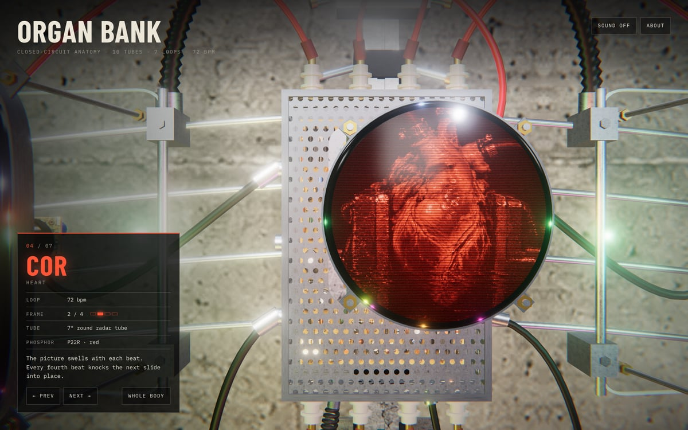
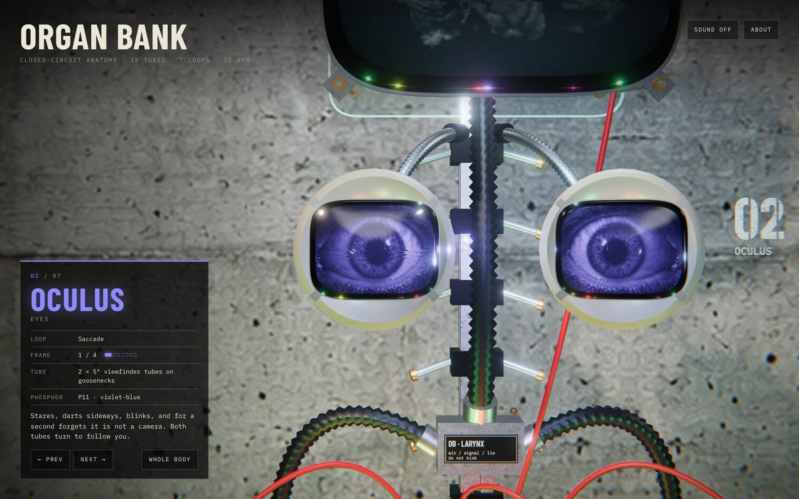

# Organ Bank

> Closed-circuit anatomy · 10 tubes · 7 loops · 72 bpm · 0 medical licences

[](https://davidyen1124.github.io/organ-bank/)

**Visit the patient: <https://davidyen1124.github.io/organ-bank/>**

## What is this?

A human body, except every organ has been swapped for a bare cathode-ray tube and
screwed to a concrete wall. This is what happens when you let an electrician
perform a transplant.

It is an interactive 3D sculpture. Drag to look around, pick a tube, read its
chart. Each organ is stuck in its own four-frame loop, timed to the rhythm it
would have had if it were still inside someone.

The arrow keys step from organ to organ, Esc steps back to the whole body, and
the scroll wheel (or a pinch) zooms.

## The patient

| No. | Organ | Hardware | Current condition |
| --- | --- | --- | --- |
| 01 | **Cerebrum** (brain) | 15″ rectangular, cold white | Holds one frame for five seconds, then flashes another for a single field, as if trying to remember it. Relatable. |
| 02 | **Oculus** (eyes) | 2 × 5″ viewfinder tubes on goosenecks | Stares, darts sideways, blinks. Both tubes turn to follow you. Yes, you specifically. |
| 03 | **Pulmo** (lungs) | 2 × 14″ portrait tubes on hinges | Inflates and empties fourteen times a minute. The only part of this project that is breathing normally. |
| 04 | **Cor** (heart) | 7″ round radar tube | 72 bpm. Every fourth beat knocks the next slide into place. |
| 05 | **Gaster** (stomach) | 11″ rectangular, hung askew | Swallows frames from the top of the raster and twists them on the way down. |
| 06 | **Ren** (kidneys) | 2 × 5″ tubes on swivel arms | Two tubes, two slides out of step. They are not speaking. |
| 07 | **Intestinum** (gut) | 17″ rectangular, 9 m of coiled cord | Scrolls sideways forever. Nothing is held and nothing is digested. |

Prognosis: stable, as long as nobody trips over the power strip.

## FAQ

**Is this a real organ bank?**
No. Please do not email me about kidneys. The first deployment had to be called
`organ-bank-nine`, because `organ-bank.vercel.app` was already taken by an actual
organ-donation site, which is fair. It has since been transplanted to GitHub
Pages. No signs of rejection so far.

**Is it medically accurate?**
One of the heart slides is a heart clamped in a bench vise. So: no.

**Does it make noise?**
Optionally. Mains hum, tube hiss, a relay click when a slide lands and a soft
thump under the heart. Sound is off until you ask for it, because I am not a
monster.

**Why are the eyes following me?**
They do that.

For the record:

| The heart, in a vise | The eyes, doing that |
| --- | --- |
|  |  |

Every picture on this page is a screenshot of the site.

## What's inside

- **Rendering:** [three.js](https://threejs.org/). There are no model files.
  Every tube, yoke, cage, cable and bolt is built from code when the page loads.
  The only images are seven slide atlases and four surface textures.
- **The tubes** all run one shader ([`src/scene/screen.js`](src/scene/screen.js)).
  It draws the scanlines, the snow and the odd tearing band, and gives each organ
  its own way of changing slides: the lungs wipe, the stomach loses vertical
  hold, the kidneys comb sideways, the brain dissolves through static.
- **Warm-up:** on load each tube starts as a dot, stretches to a line and opens
  into a picture. They come on from the bottom up. The gut is first. The brain
  is last.
- **Timing:** every loop is a pure function of the clock
  ([`src/loops.js`](src/loops.js)), so the tubes stay in step and screenshots
  repeat.
- **Sound:** there are no audio files. The hum is three sawtooth oscillators at
  60, 120 and 180 Hz, the hiss and the relay click are filtered noise, and the
  heart is a sine wave falling to 34 Hz.
- **The small print** is drawn at load time too: the stencilled numbers on the
  wall, the gallery card, the tag plates. The power supply is rated 18 kV at
  9 A, serial 0007. The larynx says "do not kink".
- **Slides and textures** were generated with Codex image generation. The raw
  frames are in [`assets-src/`](assets-src). `npm run assets` packs each organ's
  four frames into one 2×2 greyscale atlas.
- **Slow devices** get a lower resolution rather than a lower frame rate, and
  `prefers-reduced-motion` calms the swinging and stops the camera drifting.

## Operating on it yourself

```sh
npm install
npm run dev      # vite dev server
npm run build    # production build into dist/
npm run preview  # serve the build
```

URL flags: `?focus=heart` opens on one organ (`brain`, `eye`, `lungs`, `heart`,
`stomach`, `kidney` or `gut`), and `?t=12.5` freezes the clock at that second,
which is how the pictures on this page were made to hold still.

The rest of the surgical kit:

- `npm run assets` turns the raw frames in `assets-src/` into the 2×2 slide
  atlases and scene textures in `public/assets/` (via sharp).
- `scripts/gen-images.sh` regenerates those raw frames with the Codex CLI's
  image generation. You only need this if you want different organs.
- `scripts/qa.mjs`, `scripts/e2e.mjs` and `scripts/live.mjs` drive a headless
  browser around the piece and take its picture. They use the Google Chrome in
  `/Applications` and look for the site at `http://127.0.0.1:5179` unless you
  set `URL`, for example `URL=http://localhost:5173 node scripts/e2e.mjs`.
  Pictures land in `logs/shots/`, which is git-ignored.

Where things live:

```
index.html       the page: canvas, specimen card, about dialog
src/main.js      boot, camera, render loop
src/organs.js    the seven specimen cards
src/loops.js     slide timing: heartbeat, breath, saccades
src/scene/       tubes, armature, cables, the concrete room
src/sound.js     the optional room tone
src/ui.js        organ list, specimen card, buttons
public/          shipped as-is: slide atlases, textures, the social card
assets-src/      the raw generated frames and textures (not shipped)
scripts/         asset pipeline, image generation, browser QA
docs/            the pictures on this page
```

## Deploying

Pushing to `main` runs [a GitHub Actions workflow](.github/workflows/pages.yml)
that builds with Vite and publishes `dist/` to GitHub Pages. The build uses
relative paths (`base: './'`), so it works under `/organ-bank/` or anywhere else.

## Credits

Made as a study after the video sculptures of **Alan Rath** (1959–2020), who
taught picture tubes to behave like body parts. It borrows his vocabulary of
exposed tubes, armatures and cable and is not a reproduction of any of his works.

Slide frames and surface textures were generated with Codex image generation.
The hardware is modelled procedurally in [three.js](https://threejs.org/).

No organs were harmed. One was put in a jar.
