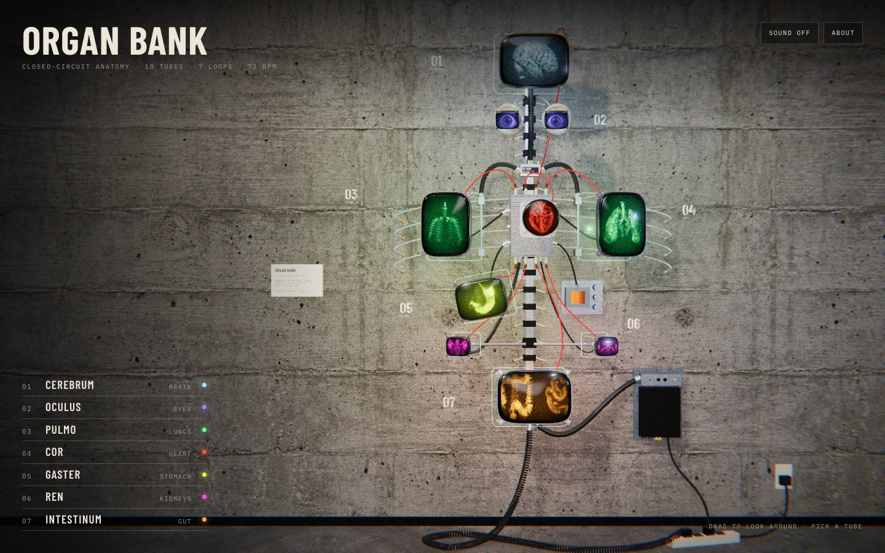

# Organ Bank

> Closed-circuit anatomy · 10 tubes · 7 loops · 72 bpm · 0 medical licences

**[Visit the patient → organ-bank-nine.vercel.app](https://organ-bank-nine.vercel.app/)**

[](https://organ-bank-nine.vercel.app/)

A human body, except every organ has been swapped for a bare cathode-ray tube and
screwed to a concrete wall. This is what happens when you let an electrician
perform a transplant.

It is an interactive 3D sculpture. Drag to look around, pick a tube, read its
chart. Each organ is stuck in its own four-frame loop, timed to the rhythm it
would have had if it were still inside someone.

## The patient

| No. | Organ | Hardware | Current condition |
| --- | --- | --- | --- |
| 01 | **Cerebrum** (brain) | 15″ rectangular, cold white | Holds one frame for five seconds, then flashes another for a single field, as if trying to remember it. Relatable. |
| 02 | **Oculus** (eyes) | 2 × 5″ viewfinder tubes on goosenecks | Stares, darts sideways, blinks. Both tubes turn to follow you. Yes, you specifically. |
| 03 | **Pulmo** (lungs) | 2 × 14″ portrait tubes on hinges | Inflates and empties fourteen times a minute. The only part of this project that is breathing normally. |
| 04 | **Cor** (heart) | 7″ round radar tube | 72 bpm. Every fourth beat knocks the next slide into place. |
| 05 | **Gaster** (stomach) | 11″ rectangular, hung askew | Swallows frames from the top of the raster and twists them on the way down. |
| 06 | **Ren** (kidneys) | 2 × 5″ tubes on swivel arms | Two tubes, two slides out of step. They are not speaking. |
| 07 | **Intestinum** (gut) | 17″ rectangular, 9 m of coiled cord | Scrolls sideways forever. Nothing is held and nothing is digested. |

Prognosis: stable, as long as nobody trips over the power strip.

## FAQ

**Is this a real organ bank?**
No. Please do not email me about kidneys. `organ-bank.vercel.app` was already
taken by an actual organ-donation site, which is fair, and is why this one is
called `-nine`.

**Is it medically accurate?**
One of the heart slides is a heart clamped in a bench vise. So: no.

**Does it make noise?**
Optionally. Mains hum, tube hiss, a relay click when a slide lands and a soft
thump under the heart. Sound is off until you ask for it, because I am not a
monster.

**Why are the eyes following me?**
They do that.

## Operating on it yourself

```sh
npm install
npm run dev      # vite dev server
npm run build    # production build into dist/
npm run preview  # serve the build
```

The rest of the surgical kit:

- `npm run assets` turns the raw frames in `assets-src/` into the 2×2 slide
  atlases and scene textures in `public/assets/` (via sharp).
- `scripts/gen-images.sh` regenerates those raw frames with the Codex CLI's
  image generation. You only need this if you want different organs.
- `scripts/qa.mjs`, `scripts/e2e.mjs` and `scripts/live.mjs` drive a headless
  browser around the piece and take its picture.

Where things live:

```
src/main.js      boot, camera, render loop
src/organs.js    the seven specimen cards
src/loops.js     slide timing: heartbeat, breath, saccades
src/scene/       tubes, armature, cables, the concrete room
src/sound.js     the optional room tone
```

## Credits

Made as a study after the video sculptures of **Alan Rath** (1959–2020), who
taught picture tubes to behave like body parts. It borrows his vocabulary of
exposed tubes, armatures and cable and is not a reproduction of any of his works.

Slide frames and surface textures were generated with Codex image generation.
The hardware is modelled procedurally in [three.js](https://threejs.org/).

No organs were harmed. One was put in a jar.
